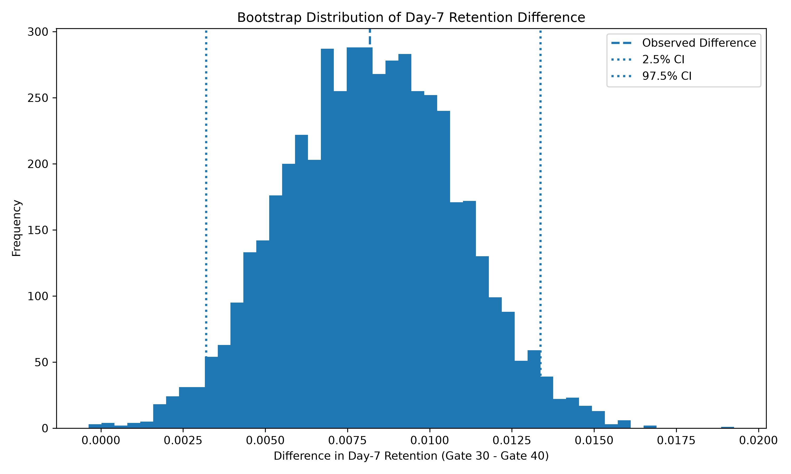

# Cookie Cats A/B Testing & Retention Analysis

## Overview

This project analyzes an A/B test from the mobile game **Cookie Cats** to evaluate whether moving the first progression gate from **level 30 to level 40** affected player retention.

The primary KPI is **Day-7 retention**, with Day-1 retention and gamerounds used as supporting measures.

## Business Question

> Does moving the first game gate from level 30 to level 40 affect player retention?

---

## Experiment Setup

| Item | Description |
|---|---|
| Control | Gate 30 |
| Treatment | Gate 40 |
| Primary KPI | Day-7 retention |
| Secondary KPI | Day-1 retention |
| Engagement metric | Gamerounds |
| Initial dataset | 90,189 players |
| Final analysis set | 90,188 players |

### Experiment Groups

| Experiment | Players | Share |
|---|---:|---:|
| Gate 30 | 44,699 | 49.56% |
| Gate 40 | 45,489 | 50.44% |

---

## Key Findings

| Metric | Gate 30 | Gate 40 |
|---|---:|---:|
| Day-1 retention | 44.82% | 44.23% |
| Day-7 retention | **19.02%** | **18.20%** |
| Day-7 retained players | 8,501 | 8,279 |

### Day-7 Retention Difference

**+0.82 percentage points**

### Statistical Result

- **Z-statistic:** 3.16
- **p-value:** 0.0016
- **95% confidence interval:** +0.31 to +1.33 percentage points
- **Significance level:** 5%

The analysis found statistical evidence of a difference in Day-7 retention between the two experiment groups.

---

## Business Impact

The experiment observed:

- **8,501** Day-7 retained players in Gate 30
- **8,279** Day-7 retained players in Gate 40
- **222** difference in retained players

If the observed 0.82 percentage-point difference were scaled to 100,000 players, it would correspond to approximately:

### **818 additional Day-7 retained players**

This is a **scaled estimate**, not an observed experiment result.

The relative difference compared with Gate 40 was approximately **4.50%**.

---

## Data Preparation

The dataset was checked for:

- Missing values
- Duplicate users
- Duplicate records
- Data types
- Experiment group composition
- Extreme gameround values

The dataset had **no missing values and no duplicate user IDs**.

One unusually large gameround value was identified:

**49,854 gamerounds**

The median was **16 gamerounds**, while the second-highest value was **2,961**.

The extreme observation was excluded from the main analysis and a sensitivity analysis was performed to check whether it materially affected the result.

| Analysis | Difference | p-value |
|---|---:|---:|
| Excluding extreme value | +0.818 pp | 0.001592 |
| Including extreme value | +0.820 pp | 0.001554 |

The result remained essentially unchanged.

---

## Statistical Analysis

### Two-Proportion Test

Day-7 retention is a binary outcome: a player either returned or did not return.

A **two-proportion test** was therefore used to compare Day-7 retention between Gate 30 and Gate 40.

### Hypotheses

**H₀:** Day-7 retention is the same for Gate 30 and Gate 40.

**H₁:** Day-7 retention differs between Gate 30 and Gate 40.

---

## Confidence Interval

The estimated Day-7 retention difference was:

**+0.82 percentage points**

The analytical 95% confidence interval was:

**+0.31 to +1.33 percentage points**

The confidence interval describes the uncertainty around the estimated difference and helps interpret the size of the observed effect.

---

## Bootstrap Validation

A bootstrap procedure with **5,000 simulations** was used as an additional validation of the uncertainty estimate.

| Measure | Result |
|---|---:|
| Bootstrap simulations | 5,000 |
| Bootstrap mean difference | +0.823 pp |
| Bootstrap 95% CI | +0.32 to +1.34 pp |
| Analytical 95% CI | +0.31 to +1.33 pp |

The bootstrap and analytical confidence intervals were very close, providing a useful robustness check.



---

## Engagement Analysis

Players were grouped by gamerounds:

- **Low:** 8 or fewer rounds
- **Medium:** 9–35 rounds
- **High:** more than 35 rounds

Observed Day-7 retention:

| Segment | Gate 30 | Gate 40 | Difference |
|---|---:|---:|---:|
| Low | 1.54% | 1.64% | -0.09 pp |
| Medium | 8.68% | 7.97% | +0.71 pp |
| High | 47.66% | 46.38% | +1.27 pp |

This analysis is treated as **exploratory** because gamerounds were measured during the experiment and are therefore not clean pre-experiment characteristics.

Interaction analysis did not provide sufficient evidence that the treatment effect differed significantly across the engagement segments.

- Medium engagement: **p = 0.122**
- High engagement: **p = 0.225**

---

## Sensitivity Analysis

One extreme gameround observation of **49,854** was identified.

The main analysis excluded this observation and the result was then compared with the result including it.

| Analysis | Difference | p-value |
|---|---:|---:|
| Excluding extreme value | +0.818 pp | 0.001592 |
| Including extreme value | +0.820 pp | 0.001554 |

The conclusion remained essentially unchanged.

This provides evidence that the primary retention finding was not driven by the single extreme gameround observation.

---

## Product Context and Limitations

The analysis evaluates retention, but the dataset does not contain:

- Revenue
- Purchases
- Monetization metrics
- Long-term retention
- Long-term progression outcomes

Therefore, the analysis establishes a difference in Day-7 retention, but it does **not** establish the overall financial impact of moving the gate.

A broader product assessment would need to consider retention alongside monetization and longer-term player behaviour.

---

## Methodology

```text
Raw Data
   ↓
Data Cleaning & Validation
   ↓
Descriptive Analysis
   ↓
A/B Test
   ↓
Confidence Interval
   ↓
Bootstrap Validation
   ↓
Engagement Analysis
   ↓
Sensitivity Analysis
   ↓
Business Impact
   ↓
Dashboard & Case Study
